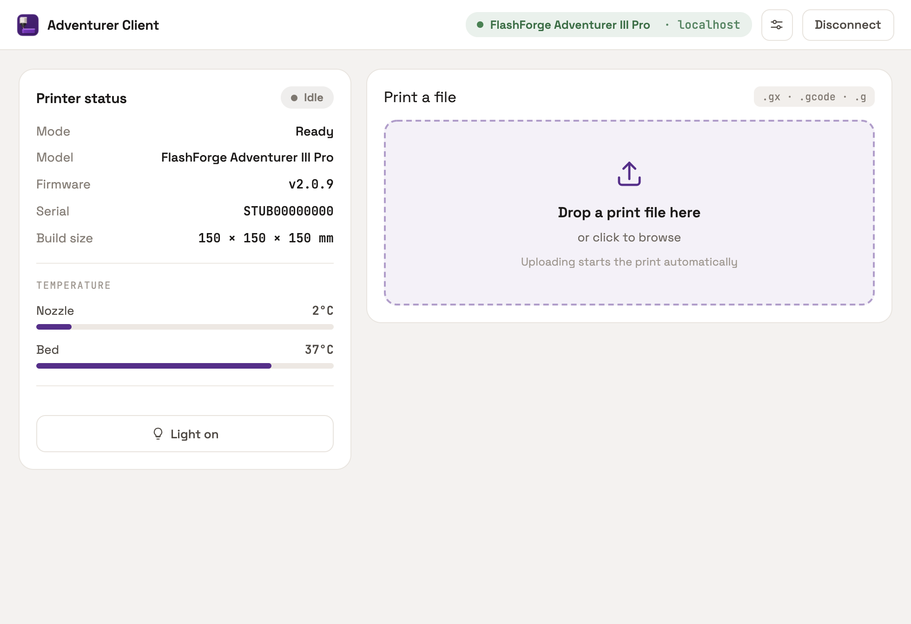

<p align="center">
  
</p>

<h1 align="center">Adventurer Client</h1>

<p align="center">
  A desktop app for FlashForge Adventurer 3D printers: watch the printer, drop in a G-code file and it prints.
</p>

<p align="center">
  
</p>

## About

Adventurer Client connects to a FlashForge Adventurer printer over your network (Wi-Fi or Ethernet). It replaces the FlashPrint "send to printer" step for people who slice in Cura or another slicer.

This project is based on [**AdventurerClientJS** by Andy Bradford](https://github.com/andycb/AdventurerClientJS). The interface has been rewritten and the upload code reworked for the current printer firmware (v2.x). It's a separate repository without the original's git history, and it doesn't aim to stay compatible with it. Thanks to Andy for the original app and for working out the printer protocol.

## Features

- Live printer status: mode, model, firmware, serial number, build size
- Nozzle and bed temperatures
- Drag-and-drop printing: drop a `.gcode`, `.g` or `.gx` file and it uploads and starts printing
- Pause, resume and stop the current print
- Enclosure light on/off
- Live camera view (optional, in Settings)
- Recent prints list for quick reprints
- Reconnects to the last printer on launch
- Settings panel for sending raw G-code/M-code commands to the printer and opening the log file

## Supported printers

Tested on a **FlashForge Adventurer III Pro running firmware v2.0.9**. Other Adventurer 3 models and the Monoprice Voxel run related firmware and may work, but they haven't been tested. Older firmware that expects the framed (`5A5AA5A5`) upload protocol is not supported.

## Printing from Cura

Plain G-code is converted on the fly before upload:

1. **Firmware fix-ups.** The Adventurer firmware understands only part of Marlin G-code. If the file contains the markers `;End Start` (end of your start G-code) and `;end gcode` (start of your end G-code), the print body between them is rewritten: Z moves get their own line, `G0` becomes `G1`, the feed rate moves to the end of each line, and temperatures are rounded to whole degrees. Files without these markers are left as they are.
2. **`.gx` wrapping.** The file is wrapped in FlashForge's `.gx` container. The printer confirms `.gx` uploads in seconds, but for plain G-code it can take over a minute.

Files that are already `.gx` (for example from FlashPrint) are uploaded unchanged.

## Installing

There are no prebuilt downloads yet. Build the app from source as described below.

### macOS: "cannot be opened because the developer cannot be verified"

The app isn't signed or notarized. On first launch, right-click **Adventurer Client** in Finder, choose **Open**, then click **Open** in the dialog. After that it opens normally.

## Building from source

You need [Node.js](https://nodejs.org) 20 or newer.

```bash
cd src
npm install
npm run electron
```

To build installers into `src/distPackages`:

```bash
npm run distmac     # .dmg for Intel and Apple silicon
npm run distwin     # NSIS installer for 32- and 64-bit Windows
npm run distlinux   # AppImage and .deb
```

For development with live reload, run `npm run electron:dev`.

## Fake printer

A fake printer is included for development without hardware. It speaks the same network protocol as the real printer, including file uploads:

```bash
node stubPrinter/stubPrinter.js
```

Then connect the app to `localhost`.

## Logs

The app writes a log file that is useful when something goes wrong with an upload. Open it from **Settings → Debug**. It lives in the app's data folder:

- macOS: `~/Library/Application Support/adventurerclient/logs/`
- Windows: `%APPDATA%\adventurerclient\logs\`
- Linux: `~/.config/adventurerclient/logs/`

## How it works

[docs/PROTOCOL.md](docs/PROTOCOL.md) describes the app's structure, the printer's network protocol and the `.gx` file format.

## License

[MIT](LICENSE). Original work © 2020 Andy Bradford, changes © 2026 Robert Wolffgang.
